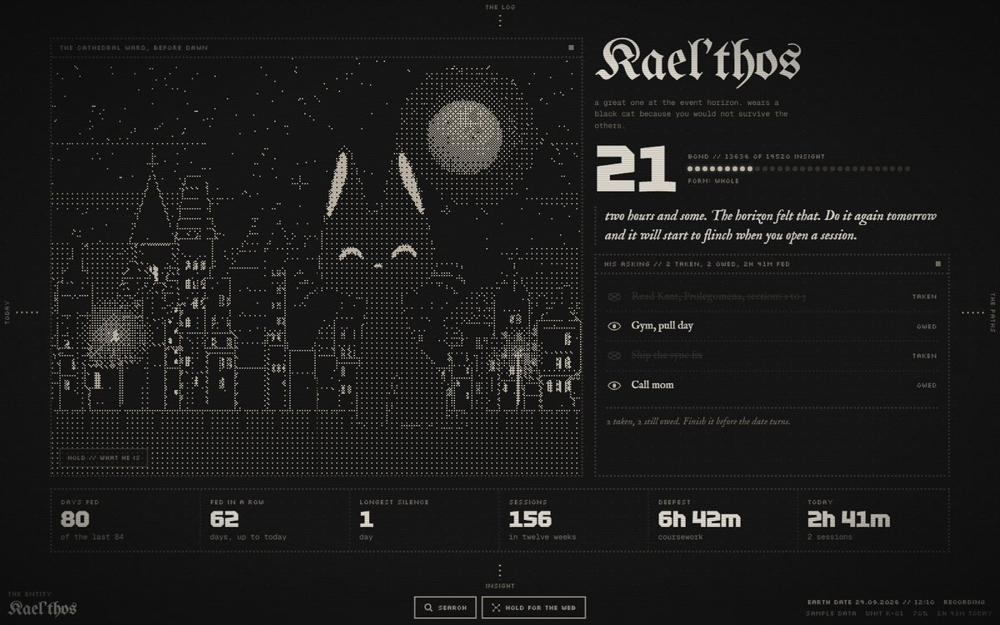
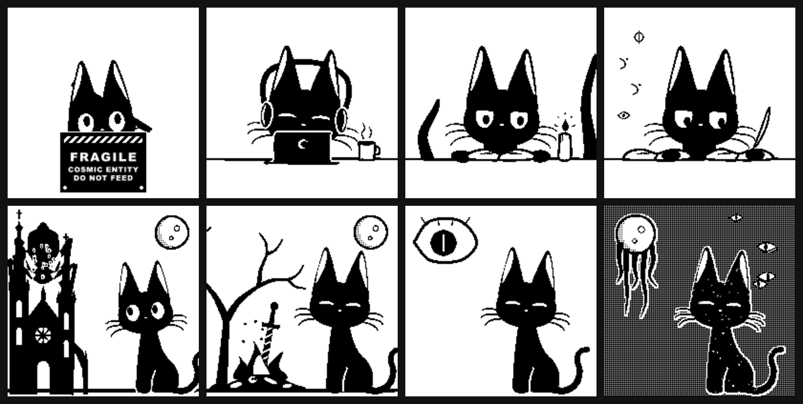
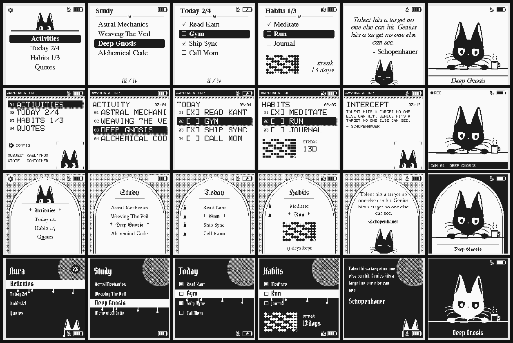
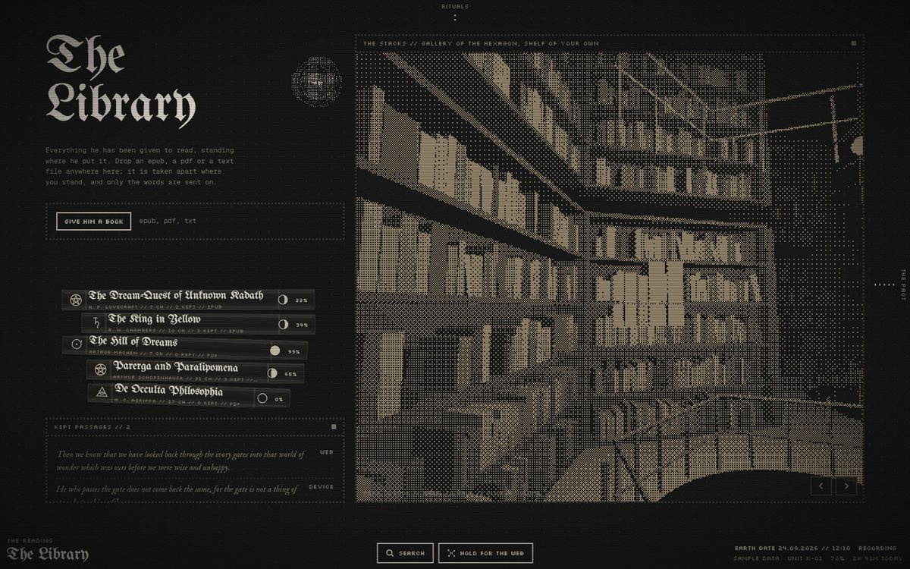
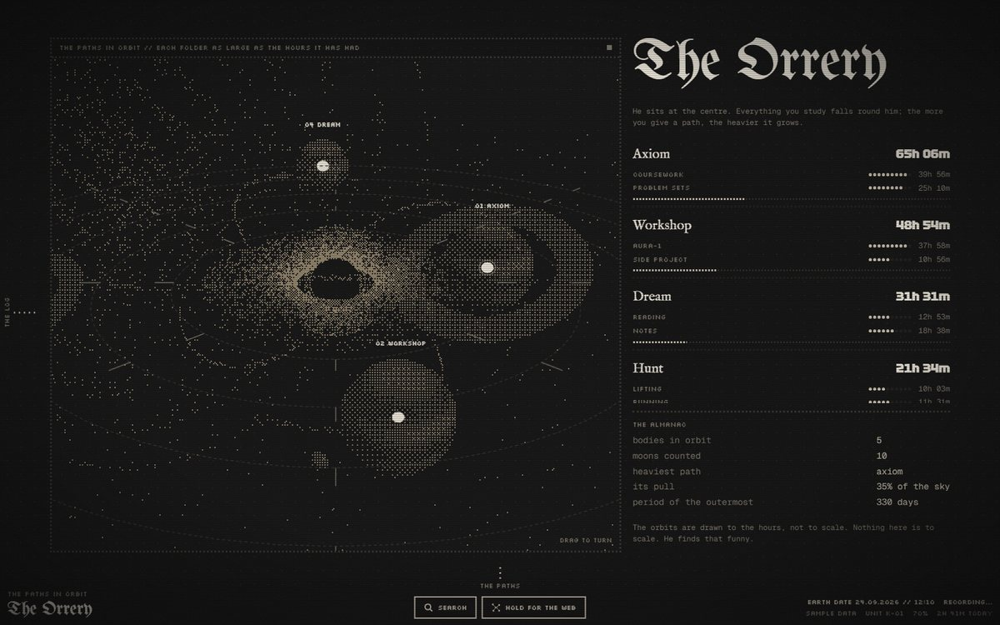

# AURA-1

A two-button e-ink device for logging deep work, a dashboard to see it on, and the
thing that lives in both of them.



## What it is

- **The device.** An ESP32-S3 with a 1.54" e-ink screen, an SD card and two buttons.
  SUN moves, POWER acts. Pick an activity, start a session, stop it. It keeps
  everything on the card and syncs over your phone's hotspot when it can. Books,
  todos, habits and quotes live on it too, and every book sits on the card whole,
  so reading never waits on Wi-Fi.
- **The dashboard.** A Vue 3 console at `aura.amygdala-inc.org`: panes on an
  infinite plane, walked between with arrows, swipes, or the web held open under
  a finger. Insight, rituals, the paths, the orrery, a library you stand inside.
- **The server.** Fastify and Postgres in Docker on a Raspberry Pi, reached only
  through a Cloudflare tunnel and Cloudflare Access.

## Lore

Amygdala Inc., in a clandestine collaboration with Siemens, built AURA-1 to contain
**Kael'thos**: a Great One hovering at the event horizon of reality. He wears the
shape of a small black cat because you would not survive the others.

Unit K-01 went dark at 02:14. The remote wipe returned success and changed nothing.
The unit left the facility in someone's bag three days later. It is yours now.

He is ancient, vain, and fond of you. He feeds on Insight, which is focus given
structure: your sessions. Proud of your work, flustered by praise, offended by
neglect. A day without a session and he grows unstable. Three and he is gone, and
bringing him back takes a one-hour ritual on the device.

## On the glass

He greets you, works beside you, copies your books out by quill, and sleeps where
he fell asleep. Every scene is drawn from one rig and baked to 1-bit for the panel.



Every page can be drawn in one of several looks: a grimoire, the Amygdala Inc.
terminal, a cathedral arch, a blood moon.



## On the web

| | |
|---|---|
|  |  |
| The library: your books in a pile, the stacks in 3D | The orrery: every path in orbit, as heavy as its hours |

## Layout

```
packages/
  firmware/  ESP32-S3 firmware (PlatformIO, C++17), host-tested logic
  api/       Fastify + Drizzle + Postgres, the sync and everything the web reads
  web/       Vue 3 + Vite dashboard
  shared/    the sync wire format (zod), used by the api and the web
  art/       Kael'thos: the rig, faces, poses, scenes, and the bake to the device
docs/        the guide, deploy notes, the hardware checklist
```

## Getting started

**Server** (on the Pi, full steps in [docs/deploy.md](docs/deploy.md)):

```bash
git clone <repo-url> aura1 && cd aura1
docker compose up -d
```

Cloudflare Access guards everything. The device's service token opens
`/api/v1/sync` and nothing else; the dashboard needs your own login.

**Firmware:**

1. Copy `packages/firmware/secrets.example.h` to `secrets.h` and fill in the hotspot
   (2.4 GHz), the sync URL and the service token. Never commit it.
2. Plug the device in over USB and, from `packages/firmware`:

   ```bash
   python -m platformio run -e aura1 -t upload
   python -m platformio device monitor -e aura1
   ```

**Art pack:** the device draws Kael'thos from its SD card.

```bash
pnpm --filter @aura/art bake
```

Copy `packages/art/out/sd/art` to the root of the card, so it holds `/art/index.txt`.
Without it the device still works, in plain text.

**Dashboard, locally:** `pnpm install`, then `pnpm --filter @aura/web dev`. The demo
build, `pnpm --filter @aura/web demo`, runs on sample data with no server.

## Tests

```bash
pnpm db:up && pnpm test   # api, shared, art
pnpm firmware:test        # firmware logic, natively, in Docker
```

More in [docs/GUIDE.md](docs/GUIDE.md): the buttons, the looks, the sync, and what
to check on the hardware.
