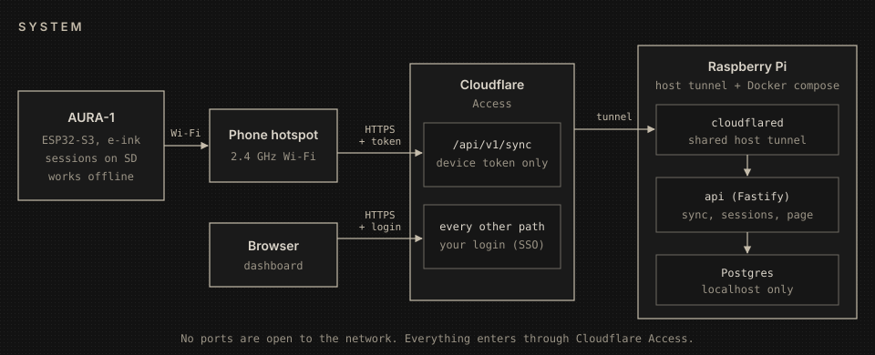
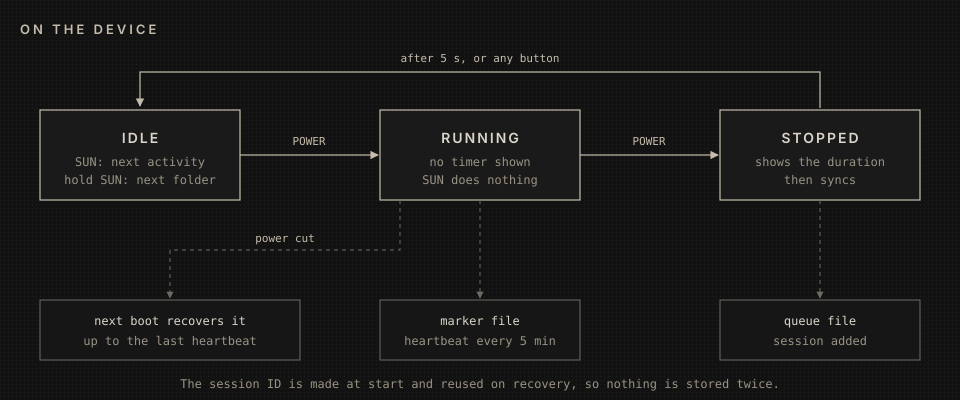
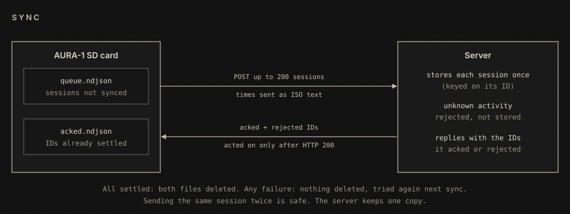
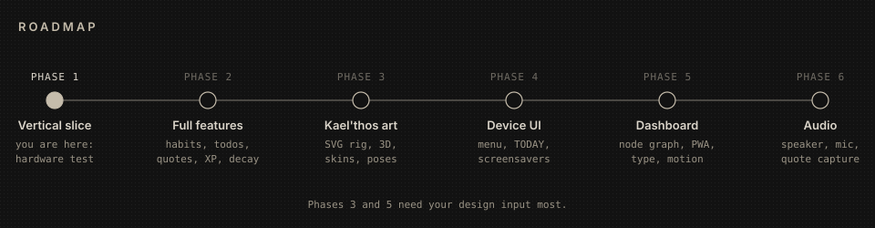

# AURA-1 Guide

AURA-1 is a two-button e-ink device that logs your work sessions. It keeps them on its
SD card while you are offline and syncs them to your own server when it finds Wi-Fi.
This guide covers how it works, how to set it up, what to test, and what comes next.

Other docs:

- [deploy.md](deploy.md): the full Raspberry Pi and Cloudflare setup
- [hardware-checklist.md](hardware-checklist.md): all 26 test steps

## How it works

- The **device** saves every session to its SD card first. It works fully offline and
  syncs when your phone hotspot is on.
- **Cloudflare Access** is the only way in. The device proves itself with a service token
  that works only on `/api/v1/sync`. Everything else, including the dashboard, needs your
  own login.
- The **Raspberry Pi** runs two containers next to your existing `cloudflared` tunnel.
  The tunnel is outbound, so no ports are open on your network. `api` stores the sessions
  and serves the web page. Both it and `postgres` are reachable from the Pi itself only.

### On the device

| Button | Folder list | Inside a folder | Running |
|---|---|---|---|
| SUN | next folder | next activity | nothing |
| POWER | open the folder | start a session | stop the session |
| hold SUN | nothing | back to the folder list | nothing |
| hold POWER | switch off | switch off | save, then switch off |

- **Power-on shows WAKING, power-off shows DORMANT.** The device then reopens the
  activity you last started. With USB plugged in it cannot cut power, so it sleeps
  instead, and POWER wakes it.
- **SEALED** shows the duration after a stop. SUN or POWER skips it.
- **The battery icon** (bottom right) fills in quarters. It reads full while charging.
- **Between presses the device sleeps** unless a computer is attached (sleep drops the
  USB serial link). Switched off, it draws almost nothing. Serial logs `battery=` every
  minute while awake, which is how to measure drain.

- **No timer is shown while you work.** That is deliberate: you see the duration only
  when you stop.
- **Folders:** AXIOM, WORKSHOP, HERESY, DREAM and HUNT. Activities inside each folder are
  sorted by when you last used them. Empty folders are hidden.
- **A power cut costs at most 5 minutes.** A running session saves a heartbeat every 5
  minutes, and the next boot recovers it. A session shorter than 5 minutes that is cut off
  by a power loss is dropped.

### Sync

- **Syncs happen** when you stop a session, at boot, and every 6 hours. The 6-hourly sync
  is skipped while a session is running. Pressing a button while it waits for Wi-Fi
  cancels the sync, so the device never ignores you; the queue goes with the next one.
- **Nothing is deleted from the device until the server confirms it.** A failed sync
  changes nothing.
- **A session sent twice is still stored once.** A lost reply, a retry, or a crash
  recovery never creates a duplicate.
- **The connection is encrypted and verified.** The device checks the server's
  certificate against Cloudflare's root authorities, so nobody on the hotspot can read or
  steal the token.

## Setup

### What you need

- **The code on GitHub.** Create an empty private repository and send the URL; the branch
  gets pushed there so the Pi can clone it.
- **Your phone hotspot on 2.4 GHz.** The ESP32 cannot use 5 GHz. On an iPhone, turn on
  *Maximize Compatibility*.
- **The device** with an SD card inserted and the LiPo connected.

### 1. Raspberry Pi and Cloudflare (about 30 min)

Follow [deploy.md](deploy.md) in order. The order is part of the security: Access is set
up before the hostname is routed, so the API is never briefly public. AURA-1 reuses the
tunnel already on your Pi; you do not create a new one.

1. Clone the repo on the Pi and run `docker compose up -d`.
2. Create the `aura-1` service token and **write down its expiry date**. An expired token
   stops syncing silently.
3. Create the two Access apps: one for your login on every path, and one for the device
   token on `/api/v1/sync` only.
4. Add `aura.amygdala-inc.org` to `/etc/cloudflared/config.yml`, pointing at
   `http://127.0.0.1:13000`, create its DNS record, and restart `cloudflared`.
5. Run the curl checks. If an unauthenticated request gets `200`, `400` or `404`, the site
   is exposed. Stop there.

### 2. Flash the device (about 15 min)

1. Copy `packages/firmware/secrets.example.h` to `secrets.h`. Fill in the hotspot name and
   password, and the service token ID and secret. Never commit this file.
2. Plug in over USB. From `packages/firmware`, run:
   `python -m platformio run -e aura1 -t upload`
3. Open the serial monitor:
   `python -m platformio device monitor -e aura1`

## What to test

These eight checks cover what the software tests on the PC cannot reach. The full list is
in [hardware-checklist.md](hardware-checklist.md).

| # | Do this | It passes when |
|---|---|---|
| 1 | Hold POWER to switch on, then let go | It stays on, and no session starts |
| 2 | First boot with the hotspot on | Serial shows `200`, and the screen shows AXIOM |
| 3 | Hotspot off: log 3 short sessions in 2 folders | No timer while running, and the duration shows after stop |
| 4 | Hotspot on: stop one more session | All 4 appear on the web page |
| 5 | Start a session, wait 6+ min, pull USB **and** battery | After boot, one ~5 min session is queued |
| 6 | Start, wait 2 min, hold POWER to switch off, switch on | One ~2 min session is queued |
| 7 | Pull power ~2 s into a sync, then reboot | Exactly one row on the page, no duplicate |
| 8 | Power off for 10 min, then compare the clock | Tells us whether the clock survives power-off |

**Send back:**

- the serial output from the first boot, and from any failure
- which checks failed, and what you saw instead
- the line starting `flash=`, which tells us which chip variant you have

## Good to know

- **After the clock resets** (flat battery, or long without power), the device will not
  start a session until it has synced once. Otherwise those sessions would be stored with
  the year 2000.
- **After renaming activities in the database**, run the one-line command in
  [deploy.md](deploy.md). Otherwise the device keeps the old names.
- **The web page shows times in UTC** for now, so it reads 1-2 hours behind Vienna time.
- **Holding POWER to switch on is safe.** The button only counts once it has been released
  after boot, so switching on never starts a session or switches straight back off.

## What comes next

1. **Fix what the hardware test finds, then merge.** The vertical slice is then done.
2. **Cleanup.**
   - Upgrade Node to 22+. This removes three workarounds.
   - Make the server bump the config version itself, so renames reach the device without
     the manual command.
   - Show local time on the page.
3. **Phase 2, full features:** manage folders and activities from the web, habits and the
   heatmap, the quote vault, XP, the decay mechanic, manual backfill, and a todo widget.
4. **Phase 3, Kael'thos:** one hand-drawn SVG rig that produces every pose and skin, for
   the device and the web. Open question for you: who draws the master, and which poses
   and skins come first.
5. **Phase 4, device UI:** a MENU above the folders with TODAY (tick off today's todos),
   HABITS and QUOTES, and the real screens and screensavers in place of today's prototype.
6. **Phase 5, dashboard:** the node-graph interface, typography, dither and motion.
7. **Phase 6, audio:** a speaker signature, and mic capture into the quote vault.
